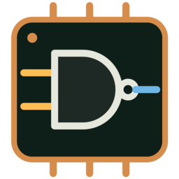

<p align="center"></p>

# makine

*[English](README.en.md)*

NAND kapısından başlayıp çalışan bir bilgisayara kadar her şeyi kendin inşa ettiğin
bir eğitim aracı. İşlemci bölümünde kendi yaptığın RISC-V işlemci gerçek programlar
çalıştırıyor; derlenmiş C programları ve Doom dahil.

## Çalıştırma

```sh
make run            # ya da: cargo run --release -p makine
```

Sık kullanılan komutlar Makefile'da; `make` yazınca listesi çıkar:

| Komut | Ne yapar |
|---|---|
| `make run` | uygulamayı çalıştırır |
| `make run-gl` | Vulkan/DirectX yerine OpenGL ile çalıştırır |
| `make test` | testleri çalıştırır |
| `make check` | biçim, clippy ve testler |
| `make doom` | Doom'u derler |
| `make c SRC=prog.c` | bir C programını derler |
| `make windows` | Linux'tan Windows `.exe`'si derler |
| `make dist-windows` | `.exe` + Doom'u `dist/makine-windows-x64.zip` yapar |
| `make clean` | derleme çıktılarını siler |

Grafik için wgpu kullanılır: Vulkan, DirectX 12, Metal ya da OpenGL'den hangisi
çalışıyorsa onu seçer. Pencere açılmazsa `WGPU_BACKEND=gl` ile OpenGL zorlanabilir
(Windows'ta: `set WGPU_BACKEND=gl` sonra `makine.exe`).

İlerleme otomatik kaydedilir: Linux'ta `~/.local/share/makine/`, Windows'ta
`%APPDATA%\makine\data\`. Her profil kendi dosyasındadır (`profile-1.json`,
`profile-2.json`…), liste `profiles.json`'dadır. Profiller sol üstteki logoya tıklayınca
açılan ana sayfadan yönetilir; bir profil metin ya da dosya olarak başka bilgisayara
taşınabilir.

Hazır sürümler: [Releases](https://github.com/rytsh/makine/releases) sayfasında Windows
ve Linux için zip dosyaları var (Doom dahil).

### Windows

1. [Rust](https://rustup.rs) kur (`rustup-init.exe`, varsayılan seçenekler). İstediğinde
   "Visual Studio Build Tools"u da kur ("Desktop development with C++").
2. Depoyu indir ve çalıştır:

   ```powershell
   git clone https://github.com/rytsh/makine
   cd makine
   cargo run --release -p makine
   ```

   Program `target\release\makine.exe` olarak oluşur; tek dosyadır, başka bir yere
   kopyalanabilir.

3. Doom ve C programları için [LLVM](https://github.com/llvm/llvm-project/releases)
   gerekir (`clang` ve `ld.lld`): `winget install LLVM.LLVM`, sonra yeni bir terminal aç.

   ```powershell
   powershell -ExecutionPolicy Bypass -File examples\doom\build.ps1
   powershell -ExecutionPolicy Bypass -File sdk\build.ps1 examples\c\merhaba.c
   ```

   `doom.elf` dosyasını `makine.exe`'nin yanına koyarsan uygulama onu orada da bulur.

Linux'tan Windows için derlemek istersen: `cargo install cargo-xwin`, sonra
`cargo xwin build --release -p makine --target x86_64-pc-windows-msvc`. C çalışma
zamanı statik bağlandığı için (`.cargo/config.toml`) `makine.exe` Visual C++
Redistributable kurulu olmayan makinelerde de çalışır.

## Nasıl oynanır

- Soldaki "Parçalar" listesinden bir parçayı tuvale **sürükle**.
- Bir çıkış ucundan bir giriş ucuna sürükleyerek **tel çek**.
- Soldaki giriş kutularına **tıklayarak** değer değiştir; teller canlı olarak yanar.
- Bir parçaya **sağ tıkla**: sil, tekrar sayısı (aynı parçadan yan yana N kopya),
  bus grupları ya da sabit değer. Bir giriş ucuna sağ tıklamak teli koparır.
- Tekerlek ile yakınlaştır, boş alanı sürükleyerek kaydır.
- NOT, AND, OR, XOR, NAND ve MUX standart mantık sembolleriyle çizilir; soldaki
  **Kapı sembolleri** kutusuyla kutu görünümüne dönülebilir.
- **F11** pencereyi tam ekran yapar (soldaki **Tam ekran** kutusu da aynı işi görür ve
  ayar hatırlanır).
- Parçaya tıklayarak seç (Shift ile ekle, Shift+sürükle ile kutu çiz); seçili parçalar
  birlikte taşınır. **Delete** siler, **Ctrl+C / Ctrl+V / Ctrl+D** kopyalar, yapıştırır,
  çoğaltır; **Ctrl+Z / Ctrl+Y** geri alır ve yineler.
- **Test et** çipini kontrol eder. Geçersen çip sonraki seviyelerde parça olarak açılır.
- **Çözümü gör**, örneği devrelerinin yanına ayrı bir sekmede açar; devre adı ve **Örnek** sekmesiyle geçiş yap.
  Örnek sekmesini aşağı sürükle: çözümü başka monitöre
  taşıyıp kendi devrenle birlikte inceleyebilirsin. Pencereyi kapatmak örneği sekmeye
  geri alır; kendi devren ve geri alma geçmişin korunur.

Seviye ve serbest çipler tarayıcı gibi ayrı devre sekmelerinde açılır.
Sekmeleri sürükleyerek sırala; sonradan açılanları **×** veya orta tıklamayla
kapat (ilk sekme açık kalır). Sekmeyi kapatmak devreyi silmez. Uzun listelerde
sekme çubuğu kayar; etkin sekme otomatik görünür alana gelir.
**Ctrl+Tab / Ctrl+Shift+Tab** devreler arasında geçer, **Ctrl+W** sekmeyi kapatır
(metin alanı odakta değilken). Her devrenin kamera, seçim, giriş, simülasyon ve
geri alma durumu sekmeler arasında korunur.

Devre sekmesini aşağı sürükleyerek ayrı pencerede düzenle.
**Sekmeye geri al** ile geri dön; **Çubuğa sürükle** tutamacı sekme çubuğuna
bırakmayı da destekler. Pencereler arası sürüklemeyi sınırlayan sistemlerde
düğmeyi kullanabilirsin. Ayrılan pencereler ana pencerenin çerçeve tercihini izler.

**Parçalar** listesinin üstündeki **Parça ara**, çip kimliği ve Türkçe/İngilizce
başlıklarda arar (`Counter32`, `program sayaci`, `program counter` gibi).
Temel NAND ve bus araçları önce, tamamlanan çipler bölüm gruplarında görünür.
Arama grupları otomatik açar; **Esc** veya **Aramayı temizle** filtreyi kaldırır.
Arama yeni parça açmaz: seviyenin izinleri ve serbest çiplerin döngü kuralları korunur.

Dil, hızlı simülasyon, kapı sembolleri, tam ekran ve pencere çerçevesi seçenekleri
**Ana sayfa → Ayarlar** bölümündedir; üst çubuktaki dişli kaldırılmıştır.

Sağ panel tek uzun liste yerine konuya göre ayrılır:
- **Devre / Öğren / Karşılaştır:** hedef ve canlı girişler; kod/Dünya etkinlikleri,
  anlatım ve ipuçları; kapı sayıları ve örnek çözüm. **Test et**, Geri al ve Yinele
  panelin altında sabit kalır.
- Kod görünümünde **Görev / Dosyalar / İzle:** aktif görev; taslak ve dosya yönetimi;
  çalışan programın register/RAM değerleri. Görev sınama düğmesi kaydırmadan erişilir.

## Dünya ve işlemci atölyesi

**Dünya**, parçaları serbestçe yerleştirip uçtan uca tel çektiğin canlı bir
elektronik tezgâhıdır. Shift+sürükle ile seç; **Modül yap** ile adlandır;
çift tıklayarak içine gir (üstteki yol çubuğu ya da Esc ile çık). İç içe modüller özgün yerleşimi ve
çalışan devreyi korur. Tel adları, elle eklenen dirsekler, hizalama ve
tıklanabilir küçük harita büyük şemaları düzenlemeyi kolaylaştırır.

Telde sağ tık → **Sinyali izle**: son 256 simülasyon adımını incele,
**Değişince dur** ile bir değişimi yakala. **Saat çevrimi** ilk saatin sonraki
yükselen kenarına ilerler. Bunlar kaydedilen devreyi değiştirmeyen yerel
inceleme araçlarıdır. Modüller ve teller yerel ağda ya da internette birlikte
düzenlenebilir. İnternet için bir aracı sunucu gerekir: `make relay` ile derlenen
`makine-relay`'i herkesin ulaşabildiği bir makinede çalıştır; paylaşan bir oda kodu
alır, öteki o kodla katılır.

**Örnek projeler → 4004 atölyesi aç** kapılardan kurulmuş bir 4-bit
aritmetik/kontrol çekirdeği açar. Akümülatör, taşıma, 16 yazmaç, 12-bit PC,
üç dönüş adresi ve 4 KiB program ROM'u vardır. Örnek gerçek 4004 opcode'ları
ile çalışır; işlem yürütme emülatörde saklı değildir. SRC, DCL ve `Ex`
bellek/GÇ komutları da kapılardan geçer; **4004 + RAM** örneği 4002 RAM'ini
ve portlarını kullanır. **Tam 4004/MCS-4 uyumluluğu değildir:** RAM tek düz
bir bellektir, 4001 yongaları ve WPM yoktur; saat ve dış bus
sadeleştirilmiştir. [Kapsam ve örnek program](docs/wiki/4004.md).

Yeni eğitim bölümünde 4-bit MUX, taşımalı toplayıcı, yazmaç ve 12-bit program
sayacı alıştırmaları bulunur. RISC-V / Doom yolu korunmuştur.

## Wiki

Soldaki **📖 Wiki** bölümü, her parçanın arkasındaki fikri anlatır:
transistörden NAND'e, De Morgan'dan toplayıcılara, flip-flop'tan RISC-V
işlemciye. Her seviyenin **Öğren** bölümündeki **📖 Wiki'de oku** bağlantısı ilgili sayfayı
açar; sayfalardaki seviye bağlantıları da seni o seviyeye götürür.

Sayfalar `docs/wiki/` altında düz Markdown dosyalarıdır; GitHub'da da okunabilir.
Programa gömülür, `.exe` tek dosya kalır. Yeni sayfa eklemek için:

1. `docs/wiki/yeni.md` yaz. Başına, anlattığı seviyeleri yaz:
   `<!--` / `seviyeler: Latch, DFF` / `-->`
2. `crates/app/src/wiki.rs` içindeki `PAGES` listesine ekle.
3. Resim kullanıyorsan `docs/wiki/img/`'e koy ve `IMAGES` listesine ekle.

Testler eksik sayfa, kırık bağlantı, gömülmemiş resim ya da sayfası olmayan seviye
olursa uyarır. Şemalar `docs/diagrams/make.py` ile çizilir (`make diagrams`);
fotoğraflar yapay zekâ ile üretilmiştir.

## Bölümler

1. **Mantık:** NOT, AND, OR, XOR, MUX, DEMUX, 32-bit MUX
2. **Aritmetik:** yarım/tam toplayıcı, 8 ve 32-bit toplayıcı, çıkarıcı
3. **Hafıza:** SR mandal, D mandal, D flip-flop, 1-bit kayıt, 32-bit register,
   program sayacı, 8 kelimelik RAM
   - **Bellek ve ROM (isteğe bağlı):** adres çözücü, sabitlerden 4×8-bit ROM,
     4×8-bit RAM, programı ROM'a kodlama ve saatle komut getirme.
     Üç Mini kod görevi ve üç Dünya deneyiyle kaynak → bayt → devre bağlantısı;
     adres/veri genişliği, saat kenarı ve bayt sırası için adım tabloları.
     [Alıştırmalar ve program yazmaya geçiş](docs/wiki/rom.md).
   - **Mini işlemci (isteğe bağlı):** topla/çıkar, kontrol ve 8-bit akümülatörlü küçük
     bir işlemci; geçince programları kendi devrende adım adım çalıştırırsın
4. **ALU:** sıfır testi, karşılaştırıcı, sola/sağa kaydırıcı, ALU, register dosyası
5. **İşlemci:** komut çözücü, kontrol birimi, dallanma, yükleme/saklama birimleri,
    çarpma/bölme, ve hepsini birleştiren **RV32IM işlemci**
6. **İşlemci atölyesi:** 4-bit seçici, taşımalı toplayıcı, yazmaç ve 12-bit program sayacı
7. **Hızlı işlemci (isteğe bağlı):** elde seçmeli hızlı toplayıcı, iki aşamalı boru hattı,
   veri yönlendirme, önbellek, adım adım çarpma/bölme ve onu kullanan hızlı saatli
   işlemci. Bu seviyeler yalnızca doğruluğu değil hızı da ölçer: en uzun kapı yolu,
   kendi Adder32'ninkine göre sınırlıdır. Çok adımlı bölücüyle işlemcinin yolu ~2400
   kapıdan ~120'ye iner.
   [Apple ve ARM çekirdekleri neden hızlı?](docs/wiki/hizli.md)
8. **Grafik işlemci (isteğe bağlı):** dört şeritli SIMD toplayıcı, kenar fonksiyonu, üçgen
   testi, ekran tarayıcı ve rasterleyici; sonra renkli piksel, derinlik tamponu ve
   birden fazla üçgen. Rasterleyicin Dünya'da 32×32 bir ekrana üçgen, sahne
   rasterleyicin de renkli ekrana dört üçgenlik bir sahne çizer. [GPU nasıl çalışır?](docs/wiki/gpu.md)

İşlemci testi, gerçek programları senin işlemcinde ve bir referans işlemcide yan yana
çalıştırır ve her komuttan sonra karşılaştırır. Bir fark olursa hangi komutun, hangi
register'ın yanlış olduğunu söyler.

## Programlama atölyesi

Programlama ayrı bir sekme değil, seviyelerin içindedir: her seviyenin altında o devreyi
kullanan kod dersleri (↳) listelenir ve sağ panelde **Kur → Kodla → Dünya'da dene** adımları
çıkar. Aynı çalışma Dünya'da da açılır; derlediğin program seçtiğin ROM'a yüklenir ve canlı
devrede çalışır (geri alınabilir). CPU'yu bitirmeden de kod yazılabilir. Program taslakları
profilde otomatik saklanır. **Derle → Baştan yükle → Bir kaynak satırı** ile
kendi assembly'ni yazıp izle; adres/makine kodu, register, bellek ve son adımda
değişenler birlikte gösterilir. Referans işlemci veya tamamladığın CPU kullanılabilir.

- Yirmi uygulamalı ders: register'lardan döngülere, dizi/metin, fonksiyon, konsol,
  piksel ve bellek kopyalamaya. Görevler farklı girişlerle test edilir;
  hatalı örneği debugger'da yeniden açabilirsin.
- Bellek ve ROM seviyelerinde ayrıca üç Mini kod görevi: programı değiştirme,
  farklı RAM girdileriyle iki katını hesaplama ve etiketli geri sayım. Görevler kendi
  sıralarıyla açılır; örnek MiniCpu devresinde RAM yazma sırası ve HLT sınanır.
- Mini CPU ve 4004 için etiketli assembler, ROM hex dışa aktarımı ve devreye yükleme.
- Özel komut seti tasarımı: kelime/opcode/argüman tanımları, JSON paylaşımı ve kendi
  serbest CPU çipine ROM/RAM bağlama. Kodlama tanımı otomatik emülatör eklemez.
- On adımlı [komut seti eğitimi](docs/wiki/komutseti.md): bit bütçesi, etiketler,
  kontrol tablosu, kapılara dönüşüm, saat ve veri yolu; sonunda kendi çipin gerçek
  programlarla sınanır. Mini CPU yolu yedi ara seviyeden oluşur.
- Bütün devre seviyelerinde somut örnek, sık hata, deney ve kaydedilen notlar var.
  Programlama görevleri önkoşullarla sırayla açılır; eski tamamlamalar korunur.
- Fibonacci, sıralama, iç içe çağrılar, konsol yankısı ve grafik/klavye projeleri.

[Ayrıntılı kullanım ve örnekler](docs/wiki/programlama.md).

## Bilgisayar

İşlemciyi bitirince üstteki **Bilgisayar** açılır: senin işlemcin + 16 MB RAM +
320×200 ekran + konsol + klavye. Örnek programlar (assembly) ya da kendi programın
(assembly `.s` veya RISC-V ELF) yüklenebilir.

- **⚡ Hızlı simülasyon:** testi geçmiş çipler kapı kapı değil, aynı davranışı gösteren
  bir Rust modeliyle simüle edilir. Kapalıyken her şey NAND seviyesinde çalışır
  (işlemci ~140 bin NAND, saniyede ~1500 komut). Açıkken saniyede ~100 bin komut.
- **🚀 Turbo:** işlemcini testlerde karşılaştırdığımız referans emülatörü kullanır
  (saniyede ~200 milyon komut). Doom için gerekli.
- **🎮 Oyna:** sadece bilgisayarın ekranını gösterir ve tam ekrana geçer; bir oyun gibi.
  Çıkmak için **F10**.

### Doom

```sh
examples/doom/build.sh          # doomgeneric + DOOM1.WAD indirir, build/doom.elf üretir
                                # Windows: examples\doom\build.ps1
```

Sonra Bilgisayar > **Doom**. Ekrana tıkla; oklar yürür, Ctrl ateş eder, boşluk kapı
açar, Enter menüde seçer. Gerekenler: `clang`, `ld.lld`, `curl`, `git`.

### Kendi C programın

```sh
sdk/build.sh examples/c/merhaba.c -o merhaba.elf
# Windows: sdk\build.ps1 examples\c\merhaba.c -Out merhaba.elf
```

`sdk/` küçük bir libc (printf, malloc, string, dosyalar), başlangıç kodu ve linker
betiği içerir. Cihazlar için `sdk/include/makine.h`'ye bak. İlk derlemede kayan nokta
ve 64-bit bölme rutinleri LLVM compiler-rt'den indirilir.

Bellek haritası:

| Adres | Cihaz |
|---|---|
| `0x00000000` | RAM; programlar burada başlar |
| `0x10000000` | konsol: yazılan bayt ekrana basılır, okuma sıradaki tuşu verir |
| `0x10000004` | zaman: başlangıçtan beri geçen milisaniye |
| `0x10000008` | klavye: sıradaki tuş olayı (bit 8 = basıldı, alt bayt = tuş) |
| `0x1000000C` | yazınca ekranı gösterir |
| `0x11000000` | ekran pikselleri, her biri bir `0x00RRGGBB` kelimesi, satır satır |

## Gerçek donanım

Bir seviyenin ya da serbest çipin panelindeki **🔌 Gerçek donanıma aktar** bölümü
çipi Verilog'a çevirir. Bu Verilog'u Icarus Verilog'da test edebilir, Yosys ile
sentezleyebilir, bir FPGA'ya yükleyebilir ya da [Tiny Tapeout](https://tinytapeout.com)
ile gerçek bir çip olarak ürettirebilirsin. Her çip ayrı bir Verilog modülü olur ve
NAND kapıları olduğu gibi kalır. Test tezgâhı, seviyenin kendi testini ya da
makine'nin simülasyonunu kullanır. Bütün örnek çözümler, RISC-V işlemci de dahil,
Icarus'ta `PASS` verir. Ayrıntılar Wiki'deki **Gerçek çip** sayfasında.

İşlemci seviyesini geçince **🖥 FPGA bilgisayarı kaydet** düğmesi çıkar. İşlemcinin
etrafına 64 KB RAM, bir seri port ve bir zamanlayıcı ekleyip **ULX3S** (Lattice ECP5)
kartı için hazır bir proje kurar: `make sim` bilgisayarda Verilator ile çalıştırır,
`make` FPGA dosyasını üretir, `make prog` karta yükler. `MK_RAM=64K sdk/build.sh prog.c`
ile derlediğin C programları `printf` çıktısını kartın USB seri portundan gönderir.

## Yapı

| Klasör | İçerik |
|---|---|
| `crates/sim` | Simülatör: çip modeli, NAND listesine derleme, 64 kanallı değerlendirme, yerel (Rust) parçalar |
| `crates/levels` | Seviyeler, testler, örnek çözümler, hızlı modeller |
| `crates/rv` | RV32IM: referans emülatör, assembler, disassembler, ELF yükleyici, makine (RAM + cihazlar) |
| `crates/app` | egui masaüstü uygulaması |
| `crates/hdl` | Verilog'a aktarma: modüller, test tezgâhı, Yosys betiği, Tiny Tapeout projesi |
| `sdk` | C programları için libc, başlangıç kodu, linker betiği |
| `examples` | C örneği ve Doom derleme betiği |

```sh
cargo test                                                       # bütün testler
cargo test -p makine-hdl                                         # Verilog'u Icarus/Yosys'ta dene (PATH'te varsa)
cargo test --release -p makine-levels -- --ignored               # işlemciyi NAND seviyesinde test et
cargo run --release -p makine-rv --example run -- program.elf    # komut satırında çalıştır
WGPU_BACKEND=vulkan cargo test -p makine screenshot -- --ignored # arayüz görüntüleri
```

## Sürüm yayınlama

`v0.1.0` gibi bir etiket gönderince `.github/workflows/release.yml` çalışır: Windows ve
Linux'ta makine'yi ve Doom'u test edip derler, zip'leri GitHub sürümüne ekler.

```sh
git tag v0.1.0 && git push origin v0.1.0
```

## Lisanslar

makine MIT lisanslıdır. Gömülü DejaVu fontları (`crates/app/fonts/`) Bitstream Vera
lisanslıdır, bkz. `LICENSE-DejaVu.txt`. Doom derleme betiğinin indirdiği dosyalar kendi lisanslarıyla
gelir ve depoya eklenmez: doomgeneric (GPL-2.0), DOOM1.WAD (id Software shareware,
serbestçe dağıtılabilir), compiler-rt (Apache-2.0 with LLVM exception).


## Yapılacaklar

1. Kartta deneme: ULX3S'e yükleyip seri porttan ilk "Merhaba" çıktısını görmek. Bilgisayarda
   hazır: `make sim` ile Verilator'da iki işlemci de (Cpu ve CpuSeq) C programının
   çıktısını basıyor; Yosys + nextpnr ile FPGA dosyası üretiliyor ve zamanlama analizinden
   geçiyor. Kalan: kartı bağlayıp `make prog`, sonra `screen /dev/ttyUSB0 115200`
   (macOS'ta `/dev/cu.usbserial-*`). Sorun çıkarsa logları birlikte inceleriz.
