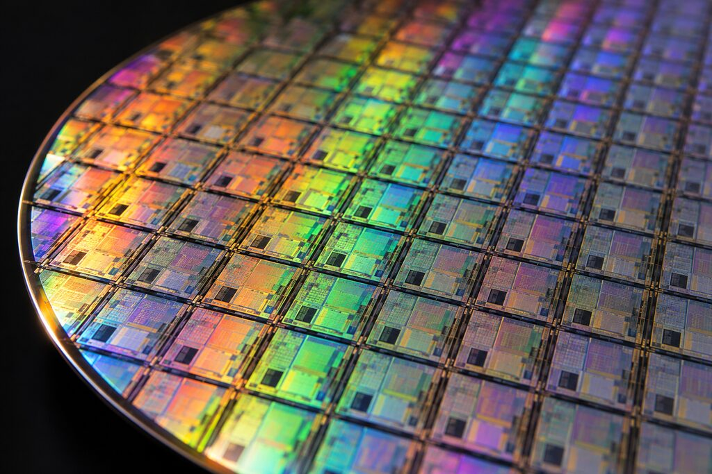

<!--
seviyeler:
-->
# Başlarken

**makine**, tek bir mantık kapısından (NAND) başlayıp gerçek programlar
çalıştıran bir bilgisayara kadar her parçayı **kendin** kurduğun bir oyun.
Bu wiki, kurduğun her parçanın arkasındaki fikri anlatıyor.

*Silikon bir pul. Her küçük kare, milyarlarca transistörden oluşan bir
çip. Sen de aynı fikri, çok daha küçük ölçekte, adım adım kuracaksın.*

## Bir bilgisayar neden yapılabilir?

Bir bilgisayarın içinde sihir yok. Sadece **iki şey** var:

1. **Anahtarlar.** Elektrikle açılıp kapanan küçük anahtarlar:
   [transistörler](transistor.md).
2. **Bunları birbirine bağlamanın akıllıca yolları.**

Anahtarları belirli şekillerde bağlayınca **mantık kapıları** çıkar.
Kapıları bağlayınca **toplama yapan devreler** çıkar. Kendi çıkışını geri
besleyen devreler **hatırlamaya** başlar. Hatırlayan ve hesaplayan devreleri
bir **saatle** adım adım çalıştırınca bir **işlemci** çıkar.

Her adım bir öncekinin üstüne kurulur. Oyundaki seviyeler de tam bu sırayı
izler.

## Oyun nasıl oynanır?

- Soldaki **Parçalar** listesinden bir parçayı tuvale sürükle.
- Bir parçanın **çıkış ucundan** (sağdaki nokta) bir **giriş ucuna** sürükleyerek
  tel çek.
- Soldaki giriş kutularına **tıklayarak** 0 ile 1 arasında değiştir. Teller
  canlı olarak yanar: **yeşil = 1**, gri = 0, mavi = çok bitli bus.
- Giriş/çıkış kutularını da sürükleyerek istediğin yere taşıyabilirsin.
- **Test et**'e bas. Geçersen çipin bir sonraki seviyede parça olarak açılır.

> [!TIP]
> Takıldığında seviyenin açıklamasındaki ipucunu oku, sonra bu wiki'de
> ilgili sayfaya bak. Her seviyenin altında **📖 Wiki'de oku** bağlantısı var.

## Okuma sırası

| Sayfa | Ne öğreneceksin |
|---|---|
| [İkilik sayılar](ikilik.md) | Bilgisayarın neden sadece 0 ve 1 kullandığı |
| [Transistör](transistor.md) | Elektrikle çalışan anahtar |
| [NAND kapısı](nand.md) | 4 transistörden bir kapı |
| [Mantık kapıları](kapilar.md) | NOT, AND, OR, XOR ve hepsinin NAND'den yapılışı |
| [Seçici ve bus'lar](mux.md) | Veriyi yönlendirmek, 32 teli tek seferde taşımak |
| [Toplama](toplama.md) | Yarım ve tam toplayıcı, eldenin yayılması |
| [Negatif sayılar ve çıkarma](cikarma.md) | İkiye tümleyen |
| [Hafıza](hafiza.md) | Mandal, flip-flop, saat |
| [Register ve RAM](register.md) | Bitleri kelimelere, kelimeleri belleğe dönüştürmek |
| [ALU](alu.md) | İşlemcinin hesap makinesi |
| [RISC-V komutları](riscv.md) | İşlemcinin konuştuğu dil |
| [İşlemci](islemci.md) | Hepsini birleştirmek |
| [Bilgisayar ve programlar](bilgisayar.md) | Ekran, klavye, C programları, Doom |
