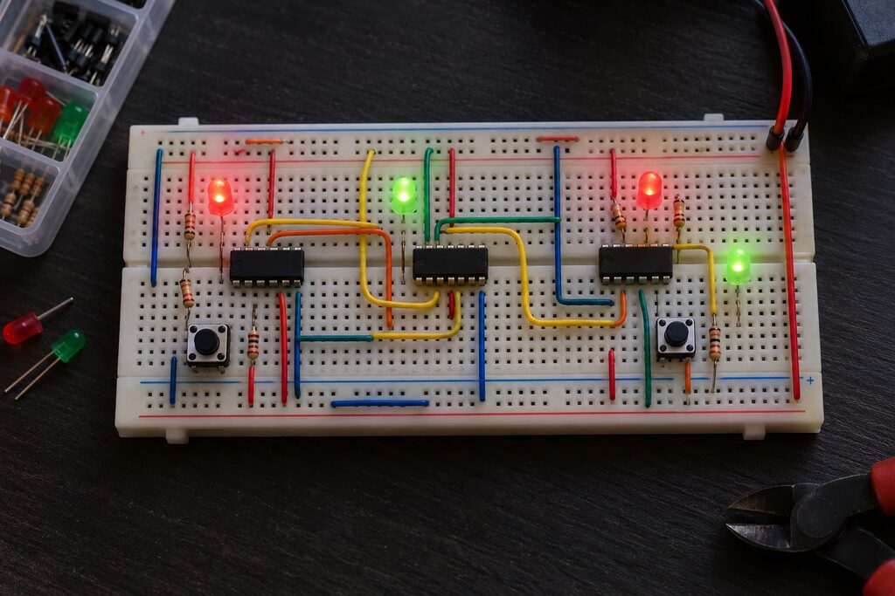

<!--
seviyeler:
-->
# Bilgisayar ve programlar

İşlemciyi bitirince soldaki **🖥 Bilgisayar** açılır. Senin işlemcin artık
bir belleğe, ekrana ve klavyeye bağlı.



*Gerçek hayatta da başlangıç böyle: bir devre tahtası, birkaç mantık çipi
ve teller.*

## Bellek haritası

İşlemci sadece "şu adrese oku/yaz" der. Hangi adreste ne olduğuna
**bellek haritası** karar verir:

| Adres | Ne var |
|---|---|
| `0x00000000` | RAM (16 MB). Program buraya yüklenir, işlemci buradan başlar |
| `0x10000000` | konsol: yazılan bayt ekrana basılır; okunca sıradaki tuşu verir |
| `0x10000004` | zaman: açılıştan beri geçen milisaniye |
| `0x10000008` | klavye: sıradaki tuş olayı (bit 8 = basıldı, alt bayt = tuş) |
| `0x1000000C` | buraya yazınca ekran güncellenir |
| `0x11000000` | ekran: 320×200 piksel, her biri bir `0x00RRGGBB` kelimesi |

Buna **bellek eşlemeli giriş/çıkış** (memory-mapped I/O) denir. Ekrana bir
şey çizmek için özel bir komut gerekmez, sadece `sw`. Gerçek bilgisayarlar da
çoğunlukla böyle çalışır.

## İlk program

```asm
        li   t1, 0x10000000     # konsolun adresi
        li   t0, 'H'
        sb   t0, 0(t1)          # 'H' yaz
        li   t0, 'i'
        sb   t0, 0(t1)          # 'i' yaz
        ebreak                  # dur
```

**Örnekler** bölümünde hazır programlar var: *Merhaba* (konsol), *Renkler*
(ekran) ve *Klavye* (ok tuşlarıyla kare).

## Hız: ⚡ ve 🚀

| Mod | Ne simüle edilir | Hız (yaklaşık) |
|---|---|---|
| ⚡ kapalı | her şey NAND seviyesinde | ~1 500 komut/sn |
| ⚡ açık | testi geçmiş çipler, aynı davranışı gösteren hızlı modellerle | ~100 000 komut/sn |
| 🚀 Turbo | referans işlemci (seninkinin test edildiği) | ~200 000 000 komut/sn |

⚡ açıkken sonuç değişmez: her model, senin çipinin geçtiği testin
aynısından geçer. Çip tasarımcıları da böyle çalışır. Önce hızlı bir
davranış modeli yazılır, sonra kapı seviyesindeki devre bu modelle
karşılaştırılır.

## C programları

Assembly yazmak uzun sürer. Bunun yerine C yazıp bir **derleyiciyle**
RISC-V komutlarına çevirebilirsin:

```c
#include <stdio.h>
#include <makine.h>

int main(void) {
    printf("Merhaba C!\n");
    for (int t = 0;; t++) {
        for (int i = 0; i < 320 * 200; i++)
            MK_SCREEN[i] = (i + t) * 0x010203;
        mk_show();
    }
}
```

```sh
make c SRC=program.c        # ya da: sdk/build.sh program.c
```

Çıkan `program.elf`'i **Dosyadan yükle** ile aç.

## Doom

1993'ün efsane oyunu **Doom**, C ile yazılmış ve kaynak kodu açık. Onu
RISC-V için derleyip senin bilgisayarında çalıştırabilirsin:

```sh
make doom
```

Sonra **👹 Doom** → **🎮 Oyna**. Oklar yürür, Ctrl ateş eder, boşluk
kapı açar. F10 ile çıkılır.

Doom saniyede on milyonlarca komut ister, bu yüzden 🚀 Turbo ile çalışır.
Ama çalışan program **aynı**: senin işlemcinin test edildiği komut seti, aynı
bellek haritası, aynı ekran. Elinde bir NAND kapısıyla başladın ve sonunda
gerçek bir bilgisayar yaptın.

## Daha ileri

- **Nand2Tetris** ("From NAND to Tetris"): bu oyuna ilham veren kurs ve
  kitap.
- **Ben Eater**'ın "8-bit breadboard computer" videoları: aynı yolculuk,
  gerçek çiplerle.
- **"Digital Design and Computer Architecture: RISC-V Edition"** (Harris &
  Harris): tek çevrimli ve boru hattılı RISC-V'nin ayrıntılı anlatımı.
- RISC-V belirtimi: <https://riscv.org/specifications/>
