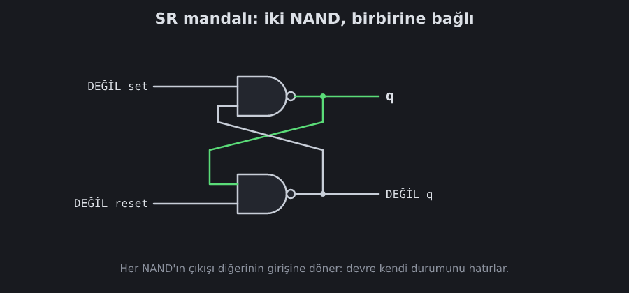
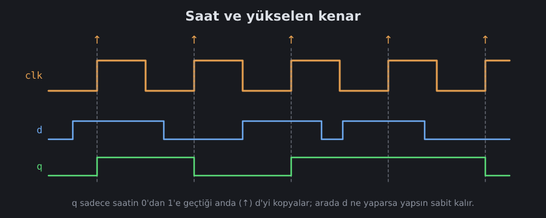

<!--
seviyeler: Latch, DLatch, DFF, Bit
-->
# Hafıza

Şimdiye kadar yaptığın devrelerin hafızası yoktu: çıkış sadece **şu anki**
girişlere bağlıydı. Bir bilgisayar ise **hatırlamak** zorunda: sayıları,
programı, nerede kaldığını.

Hafızanın sırrı **geri besleme**: bir devrenin çıkışını kendi girişine
geri bağlamak.

## SR mandalı (latch)

İki NAND'ı çapraz bağla: birinin çıkışı diğerinin girişine gitsin.



Bu devrenin **iki kararlı durumu** vardır: `q = 1` ya da `q = 0`. Bir kere
bir duruma geçince, girişler bekleme konumundayken orada **kalır**:

- `set` → q = 1 olur
- `reset` → q = 0 olur
- ikisi de 0 → q **eski değerini korur**

> [!NOTE]
> Oyundaki seviyede girişler `set` ve `reset` olarak 1 iken etkilidir.
> Bu yüzden iki NAND'ın önüne birer NOT koyarsın. Şemada bu NOT'lar
> "DEĞİL set" ve "DEĞİL reset" olarak gösteriliyor.

Simülatör bu döngüyü fark eder ve devre oturana kadar tekrar tekrar
hesaplar. Durmadan salınan bir döngü kurarsan (ör. kendi çıkışına bağlı
bir NOT) "devre salınıyor" uyarısı alırsın.

## D mandalı

SR mandalının bir sorunu var: aynı anda hem `set` hem `reset` vermek
anlamsızdır. **D mandalı** bunu çözer. Tek bir veri girişi `d` ve bir
izin girişi `en` vardır:

- `en = 1`: q, d'yi takip eder (mandal "şeffaf")
- `en = 0`: q son değerini tutar

```
set   = d VE en
reset = DEĞİL d VE en
```

## Saat ve D flip-flop

Bir işlemcide her şey **adım adım** ilerler. Bu adımları bir **saat**
sinyali belirler: sürekli 0-1-0-1 diye gidip gelen bir tel. Telefonundaki
işlemcinin saati saniyede milyarlarca kez vurur (GHz).

**D flip-flop**, d'yi sadece saatin **0'dan 1'e geçtiği anda** (yükselen
kenar) kaydeder:



Neden D mandalı yetmez? Saat 1 iken mandal şeffaftır. q değişir, q'dan
hesaplanan yeni d de mandaldan geçer, o da q'yu değiştirir… Bir sayaç saat
1 iken defalarca sayardı! Flip-flop ise kenar başına **tam bir kez**
kaydeder.

### Usta-çırak (master-slave)

İki D mandalını arka arkaya koy:

```
usta  = DLatch(d,    DEĞİL clk)   // saat 0 iken açık
çırak = DLatch(usta, clk)         // saat 1 iken açık
q = çırak
```

- Saat 0: usta d'yi izler, çırak kapalı ve q'yu tutar.
- Saat 0→1: usta kapanır ve son d'yi tutar. Çırak açılır ve onu q'ya
  verir.
- Saat 1: usta kapalı, d ne yaparsa yapsın q değişmez.

İki kapı bir arada: biri kapanmadan diğeri açılmıyor. Bir kanal kapağı
gibi.

## 1-bit kayıt

Flip-flop her kenarda d'yi kaydeder. Bazen ise "bu sefer **değiştirme**"
demek isteriz. Bunun için flip-flop'un girişine bir MUX koy:

```
d' = MUX(q, d, load)    // load=0: kendi değeri, load=1: yeni değer
```

`load = 0` iken flip-flop her kenarda **kendi çıkışını** tekrar kaydeder,
yani değer değişmez.

Sırada: [Register ve RAM](register.md).
