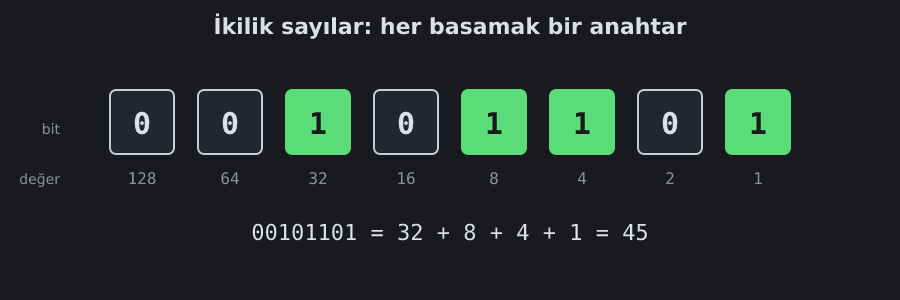

<!--
seviyeler:
-->
# İkilik sayılar

Bilgisayarın içindeki her şey (sayılar, harfler, resimler, Doom'un
haritaları) sonunda **0** ve **1**'lerden oluşur. Neden?

## Neden sadece iki rakam?

Bir tel üzerinde elektrik ya **var** ya **yok**. "Biraz var"ı güvenilir
şekilde ölçmek zordur: gürültü, ısı ve kablonun uzunluğu gerilimi biraz
oynatır. Ama "yüksek mi alçak mı?" sorusu bu oynamalara karşı çok
dayanıklıdır. Bu yüzden her tel tek bir şey taşır: **bir bit**.

| Gerilim | Anlamı |
|---|---|
| yüksek (ör. 1 V) | **1** |
| alçak (0 V) | **0** |

## İkilik sayma

Onluk sistemde her basamak bir öncekinin **10 katı** değerindedir:
birler, onlar, yüzler… İkilik sistemde ise her basamak **2 katı**:
1, 2, 4, 8, 16…



Bir ikilik sayının değeri, **1 olan basamakların değerlerinin toplamıdır**:

```
  0 0 1 0 1 1 0 1
  │ │ │ │ │ │ │ └─ 1
  │ │ │ │ │ │ └─── 2   (0)
  │ │ │ │ │ └───── 4
  │ │ │ │ └─────── 8
  │ │ │ └───────── 16  (0)
  │ │ └─────────── 32
  └─┴───────────── 64, 128 (0)

  32 + 8 + 4 + 1 = 45
```

Saymak da onluk sistemdeki gibidir, sadece 1'den sonra "elde" çıkar:

```
0, 1, 10, 11, 100, 101, 110, 111, 1000, …
```

## Bit, bayt, kelime

| İsim | Bit sayısı | Kaç farklı değer |
|---|---|---|
| bit | 1 | 2 |
| bayt | 8 | 256 |
| yarım kelime | 16 | 65 536 |
| kelime (RISC-V) | 32 | 4 294 967 296 |

Oyundaki **bus**'lar (ör. `a[32]`) yan yana 32 tel demektir: tek bir
32 bitlik sayı.

## Onaltılık (hex)

32 tane 0/1 yazmak zahmetli. Bu yüzden 4 biti tek bir **onaltılık**
rakamla yazarız: `0`–`9`, sonra `A`=10 … `F`=15.

```
1101 1110 1010 1101 1011 1110 1110 1111
  D    E    A    D    B    E    E    F    →  0xDEADBEEF
```

Oyunda bus değerleri `0x…` ile hex olarak gösterilir.

## Kendin dene

> [!TIP]
> 8-bit Toplayıcı seviyesinde girişlere `0x0F` ve `0x01` ver. Sonuç `0x10`
> olmalı: 15 + 1 = 16. Alt dört bitin hepsi 1'ken 1 eklemek, onluk
> sistemdeki 9 + 1 = 10 gibi bir sonraki basamağa elde taşır.
