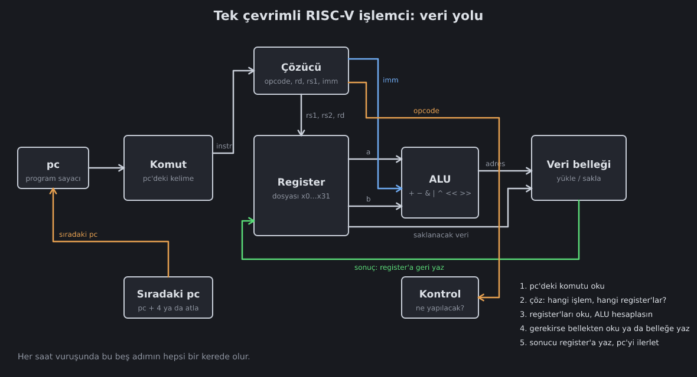

<!--
seviyeler: Cpu
-->
# İşlemci

Bütün parçalar hazır. Şimdi onları **tek çevrimli** (single-cycle) bir
işlemcide birleştiriyoruz. Her saat vuruşunda bir komut baştan sona
çalışır.

## Bir komutun yolculuğu

`add x5, x6, x7` komutunu izleyelim:

1. **Getir.** `pc` register'ı belleğe adres olarak gider. Gelen 32 bit
   `instr` girişine düşer.
2. **Çöz.** [Komut çözücü](riscv.md) alanları ayırır: opcode = hesap,
   rd = 5, rs1 = 6, rs2 = 7.
3. **Oku.** [Register dosyası](register.md) x6 ve x7'yi `a` ve `b`
   çıkışlarına verir. Saat beklemez.
4. **Hesapla.** [ALU](alu.md) `a + b`'yi hesaplar. Kontrol birimi
   opcode'a bakıp ALU'ya "topla" der.
5. **Geri yaz.** Sonuç register dosyasının `d` girişine gider. Kontrol
   birimi `we = 1` der. Saat **yükseldiğinde** x5'e yazılır.
6. **İlerle.** Aynı kenarda `pc` de `pc + 4` olur.

Saat yükselene kadar 1–4 arası adımlar sadece kapılardan geçen sinyallerdir.
Hepsi aynı anda "yerine oturur". Kenarda ise iki şey olur: register ve pc
güncellenir. Sonra aynı şey sıradaki komut için tekrar başlar.

## Kontrol birimi

İşlemcinin şefi. Opcode'a bakıp her MUX'a ve her izin sinyaline ne
yapacağını söyler:

| komut | ALU b | ALU op | geri yazılan | bellek | pc |
|---|---|---|---|---|---|
| `add` | rs2 | funct | ALU | — | +4 |
| `addi` | imm | funct | ALU | — | +4 |
| `lw` | imm | topla | **bellek** | oku | +4 |
| `sw` | imm | topla | — | **yaz** | +4 |
| `beq` | rs2 | — | — | — | **koşullu** |
| `jal` | — | — | pc + 4 | — | **pc + imm** |
| `lui` | — | — | **imm** | — | +4 |

Tabloda olmayan sinyallere "önemsiz" denir: o komut için ne olduklarının
bir önemi yoktur. Oyunun testi de onları kontrol etmez.

## Test nasıl yapılır?

İşlemci testi gerçek programları (aritmetik, dallanma, bellek, fonksiyon
çağrısı, çarpma/bölme) **iki işlemcide yan yana** çalıştırır: seninkinde ve
Rust ile yazılmış bir referans işlemcide. Her komuttan sonra pc'ler ve
bellek yazımları karşılaştırılır.

Bir fark bulunca test hangi komutun yanlış olduğunu ve yanlış değerin
**geriye doğru** nereden geldiğini söyler:

> `0x0098: 'sw t0, 52(s0)'` komutunda bellek yazımı yanlış… x5 (t0) =
> 0xFEF56DF7 olmalıydı. Bu değeri en son `0x0094: 'sra t0, a4, t1'` yazdı.

Burada sorun `sw`'de değil, ondan önceki `sra`'da: ALU aritmetik kaydırmayı
yanlış yapıyor.

## Tek çevrimin bedeli

Tek çevrimli işlemcide saat, **en yavaş komutun** bitmesini beklemek
zorundadır. Bu genelde bellekten okuyup sonra toplayan `lw`'dir. Gerçek
işlemciler bunun yerine **boru hattı** (pipeline) kullanır. Komutu 5 aşamaya
böler ve her aşamada farklı bir komut çalışır. Bir fabrika bandı gibi: her
komut yine 5 adım sürer ama her adımda bir komut **biter**.

Sırada: [Bilgisayar ve programlar](bilgisayar.md).
