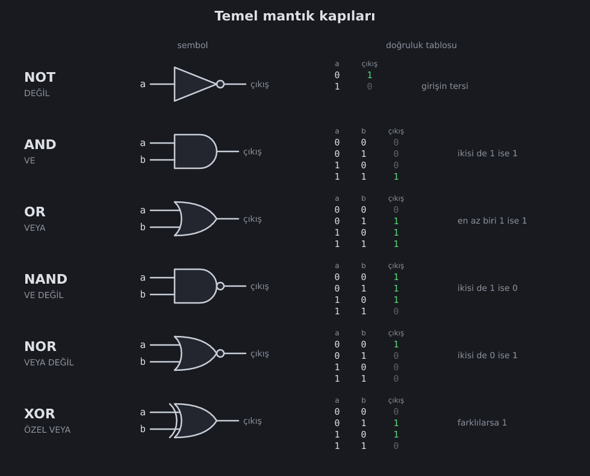
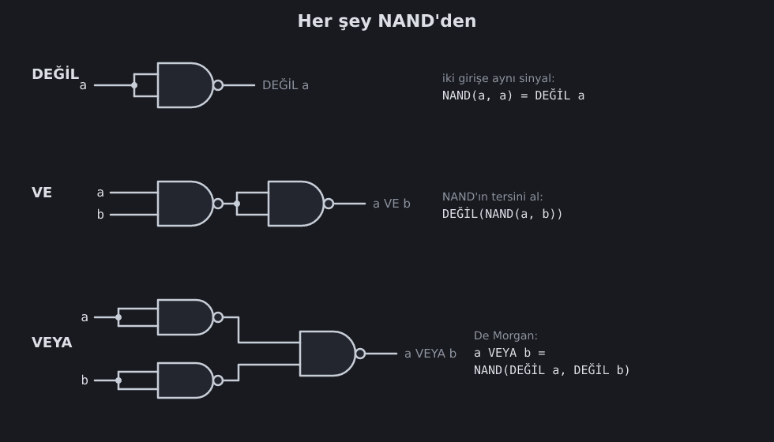

<!--
seviyeler: And, Or, Xor
-->
# Mantık kapıları

Mantık kapıları, bitler üzerinde basit kararlar veren devrelerdir. Her
kapının bir **sembolü** ve bir **doğruluk tablosu** vardır. Doğruluk
tablosu, her olası giriş için çıkışı gösterir.



Oyunda bu kapıları tuvalde aynı sembollerle görürsün. Kutu görünümünü
tercih edersen soldaki **Kapı sembolleri** kutusunu kapatabilirsin.

## Hepsini NAND'den yapmak



### DEĞİL (NOT)
`NAND(a, a)`. İki girişe aynı sinyal. Ayrıntılar [NAND](nand.md) sayfasında.

### VE (AND)
NAND, "VE DEĞİL" demek. O halde VE = **DEĞİL(NAND(a, b))**: bir NAND,
arkasına bir NOT.

### VEYA (OR): De Morgan kuralı
Burada güzel bir hile var. İngiliz matematikçi **Augustus De Morgan**
(1806–1871) şunu fark etti:

```
a VEYA b  =  DEĞİL( DEĞİL a  VE  DEĞİL b )
```

Gündelik dille: "a ya da b doğru" demek, "ikisi birden yanlış değil" demekle
aynı şeydir. `DEĞİL(… VE …)` ise tam olarak NAND'dir:

```
a VEYA b  =  NAND( DEĞİL a, DEĞİL b )
```

Yani iki NOT ve bir NAND yeter.

### ÖZEL VEYA (XOR)
XOR, girişler **farklı** ise 1 verir. Toplamanın kalbidir: 1 + 1'in alt
basamağı 0'dır, 1 + 0'ınki 1'dir. Tam olarak XOR!

Klasik çözüm 4 NAND kullanır:

```
n   = NAND(a, b)
out = NAND( NAND(a, n), NAND(b, n) )
```

Neden çalıştığını tablo ile kontrol et:

| a | b | n | NAND(a,n) | NAND(b,n) | out |
|---|---|---|---|---|---|
| 0 | 0 | 1 | 1 | 1 | 0 |
| 0 | 1 | 1 | 1 | 0 | 1 |
| 1 | 0 | 1 | 0 | 1 | 1 |
| 1 | 1 | 0 | 1 | 1 | 0 |

> [!NOTE]
> Daha önce yaptığın çipleri de kullanabilirsin: `(a VEYA b) VE DEĞİL(a VE b)`
> de XOR'dur. Daha anlaşılır ama daha çok kapı kullanır. Oyun ikisini de
> kabul eder.

## Boole cebiri

Kapılarla düşünmenin matematiğine **Boole cebiri** denir. Adını
**George Boole**'dan (1815–1864) alır. Birkaç kullanışlı kural:

| Kural | Örnek |
|---|---|
| Çift değil | `DEĞİL DEĞİL a = a` |
| De Morgan | `DEĞİL(a VE b) = DEĞİL a VEYA DEĞİL b` |
| | `DEĞİL(a VEYA b) = DEĞİL a VE DEĞİL b` |
| Sıfır/bir | `a VE 0 = 0`, `a VEYA 1 = 1` |
| Kendisiyle | `a XOR a = 0`, `a XOR 0 = a` |

1937'de **Claude Shannon** bu cebirin elektrik devreleriyle birebir
uyuştuğunu gösterdi. Dijital elektronik o gün doğdu.

Sırada: [Seçici ve bus'lar](mux.md).
