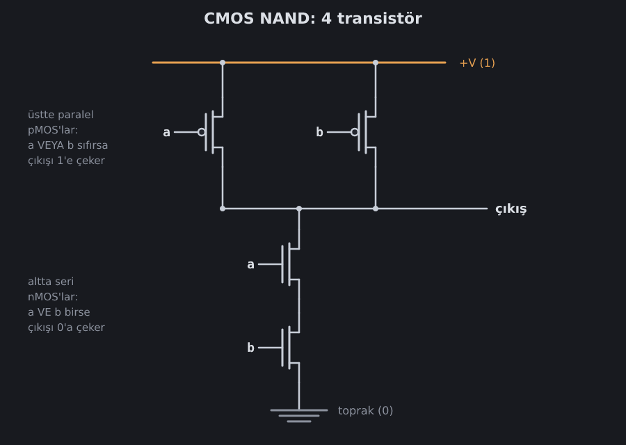

<!--
seviyeler: Not, And
-->
# NAND kapısı

**NAND**, "VE DEĞİL" (*Not AND*) demektir: **iki giriş de 1 ise çıkış 0,
yoksa 1**. Oyundaki her şey bu tek kapıdan kurulur.

| a | b | NAND |
|---|---|---|
| 0 | 0 | **1** |
| 0 | 1 | **1** |
| 1 | 0 | **1** |
| 1 | 1 | 0 |

## 4 transistörden bir NAND

Gerçek bir çipte NAND, iki [pMOS ve iki nMOS transistörden](transistor.md)
yapılır:

Ne olduğunu her giriş için izleyelim:

- **a = 1, b = 1:** Alttaki iki nMOS da iletir. Çıkışı toprağa, yani
  **0**'a bağlarlar. Üstteki pMOS'lar kapalıdır.
- **a veya b = 0:** Alttaki seri yol kopar, çünkü nMOS'lardan biri
  iletmez. Üstteki pMOS'lardan en az biri iletir ve çıkışı **1**'e çeker.

Dikkat et: çıkış hiçbir zaman hem 1'e hem 0'a bağlı olmaz. Altta **seri**
(ikisi de gerekir) olan yapı, üstte **paralel** (biri yeter) olan yapının
tam aynasıdır. CMOS'un temel kuralı budur.

## Neden NAND?

NAND **evrensel** bir kapıdır: **her** mantık devresi sadece NAND'lerden
yapılabilir. AND, OR, XOR, toplayıcı, bellek ve bir işlemcinin tamamı
dahil.

Ayrıca CMOS'ta en ucuz kapılardan biridir: 4 transistör. AND yapmak için
NAND'in arkasına bir NOT eklemek gerekir; bu da 6 transistör eder.

Bu yüzden oyun sana **sadece NAND** veriyor. Gerisini sen
kuracaksın.

## İlk görev: NOT

NAND'ın **iki girişine aynı sinyali** verirsen ne olur?

| a | NAND(a, a) |
|---|---|
| 0 | NAND(0, 0) = **1** |
| 1 | NAND(1, 1) = **0** |

Bu tam olarak **DEĞİL** (NOT) kapısı! Oyundaki ilk seviyenin cevabı bu.

> [!TIP]
> Bir çıkışı birden çok girişe bağlayabilirsin. Teli sürükle, bir girişe
> bırak; sonra aynı çıkıştan yeni bir tel daha çek.

Sırada: [Diğer mantık kapıları](kapilar.md).
