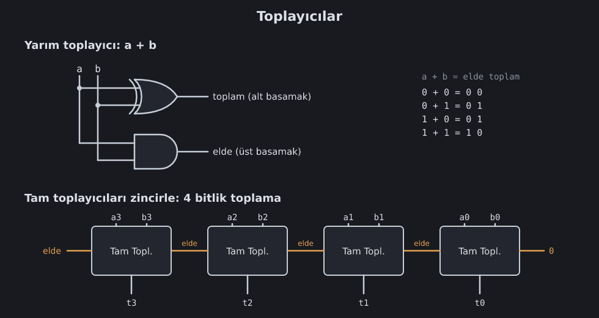

<!--
seviyeler: HalfAdder, FullAdder, Adder8, Adder32
-->
# Toplama

Toplama, ilkokuldaki gibi yapılır: sağdan sola, basamak basamak, eldeyi
bir sonraki basamağa taşıyarak.

## Yarım toplayıcı

İki biti topla. Sonuç en fazla `1 + 1 = 10` (ikilik), yani iki bit:

- **toplam** (alt basamak) = `a XOR b`
- **elde** (üst basamak) = `a VE b`

İki kapı, o kadar.

## Tam toplayıcı

Bir sayının ortasındaki bir basamak **üç** bit toplar: a, b ve sağdaki
basamaktan gelen elde (`c`). Bunu iki yarım toplayıcıyla yaparız:

1. `a + b` (ilk yarım toplayıcı)
2. çıkan toplam `+ c` (ikinci yarım toplayıcı)
3. iki eldeden biri 1 ise sonuç eldesi 1: `elde1 VEYA elde2`

| a | b | c | elde | toplam |
|---|---|---|---|---|
| 0 | 0 | 0 | 0 | 0 |
| 0 | 1 | 1 | 1 | 0 |
| 1 | 1 | 1 | 1 | 1 |

> [!NOTE]
> İki elde aynı anda 1 olamaz. Neden? İlk toplam 1 ise ilk elde 0'dır.
> Bu yüzden VEYA yerine XOR da kullanılabilirdi.

## Zincir: dalgalanan elde (ripple carry)

Tam toplayıcıları yan yana diz: her birinin eldesi solundakine gider. 8
tane dizince 8 bitlik, 32 tane dizince 32 bitlik toplayıcı olur. En sağdaki
toplayıcının `c` girişi genelde 0'dır.

Oyunda **8-bit Toplayıcı** için:

1. `a[8]` ve `b[8]`'i **Böl 1,1,1,1,1,1,1,1** ile bitlere ayır.
2. 8 Tam Toplayıcıyı zincirle.
3. Toplam bitlerini **Birleştir** ile tekrar bus yap.

**32-bit Toplayıcı** ise dört 8-bit toplayıcı demek: `Böl 8,8,8,8`.

### Hız sorunu

Zincirin sonundaki bit, eldenin en baştan **dalgalanarak** gelmesini
beklemek zorunda. 32 bitte bu 32 basamaklık bir gecikme demek. Gerçek
işlemciler bunu **ileriye bakan elde** (carry lookahead) gibi hilelerle
hızlandırır: eldeyi tek tek beklemek yerine, gelip gelmeyeceğini
önceden hesaplarlar. Oyunda simülasyon bunu umursamaz; ama gerçek bir çipte
saat hızını bu belirler.

## Elde ne işe yarar?

En üstteki toplayıcıdan çıkan elde, sonucun **sığmadığını** söyler:
`0xFFFFFFFF + 1 = 0x1_00000000`, ama 32 bit sadece `0x00000000`'ı tutar.
Bu eldeyi [çıkarma](cikarma.md) ve [karşılaştırma](alu.md) için de
kullanacağız.

Sırada: [Negatif sayılar ve çıkarma](cikarma.md).
