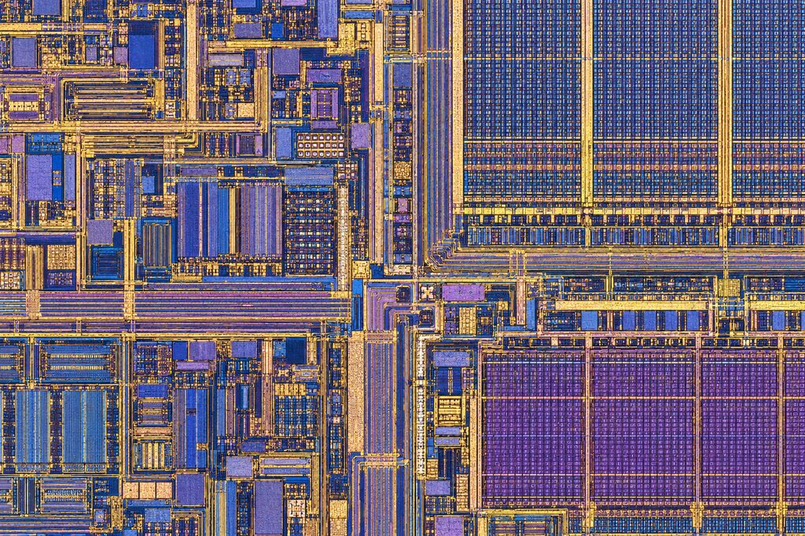
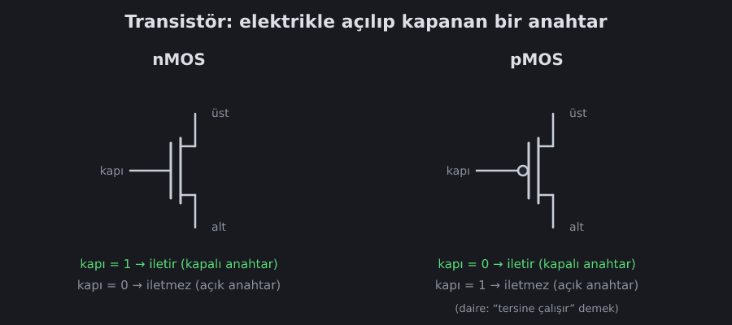

<!--
seviyeler: Not
-->
# Transistör

Bir bilgisayardaki her şey, aynı küçük parçanın milyarlarca kopyasından
yapılır: **transistör**. Transistörü elektrikle açılıp kapanan bir
**anahtar** gibi düşünebilirsin.

*Bir işlemci çipinin yüzeyi. Her renkli blok, binlerce transistörden yapılmış
bir devre: hesaplama birimleri, bellekler ve onları bağlayan bakır teller.*

## Anahtar gibi

Normal bir ışık anahtarını parmağınla açarsın. Transistörde ise "parmak"
başka bir teldir. Bu tele **kapı** (gate) denir.

Bugünkü çiplerin hepsinde iki çeşit transistör vardır:

| Çeşit | Kapı = 1 | Kapı = 0 |
|---|---|---|
| **nMOS** | iletir (anahtar kapalı) | iletmez (anahtar açık) |
| **pMOS** | iletmez | iletir |

pMOS, nMOS'un tam tersi çalışır. Sembolündeki küçük daire bu "tersine
çalışır" anlamına gelir. Aynı küçük daireyi [NAND kapısının](nand.md)
çıkışında da göreceksin.

## Neden iki çeşit?

nMOS, bir teli **0'a (toprağa)** bağlamakta iyidir. pMOS ise **1'e (+V'ye)**
bağlamakta iyidir. İkisini birlikte kullanan tasarıma **CMOS**
(*Complementary MOS*, "tamamlayıcı MOS") denir. CMOS'ta:

- Bir çıkışı ya pMOS'lar 1'e çeker ya nMOS'lar 0'a çeker. **Asla ikisi
  birden** çekmez.
- Bu yüzden devre sadece durum değişirken akım harcar, beklerken
  neredeyse hiç harcamaz. Telefonunun pili bu sayede bir gün dayanır.

## Ne kadar küçük?

| Yıl | İşlemci | Transistör sayısı |
|---|---|---|
| 1971 | Intel 4004 | 2 300 |
| 1985 | Intel 386 | 275 000 |
| 2000 | Pentium 4 | 42 milyon |
| 2020'ler | Telefon işlemcileri | 15–20 milyar |

Senin oyunda kuracağın RISC-V işlemci yaklaşık **140 000 NAND kapısı** eder.
Her NAND 4 transistör olduğuna göre bu yaklaşık **560 000 transistör**
demek: 1980'lerin sonundaki bir işlemci kadar!

## Oyunda

Oyunda transistör seviyesine inmiyoruz. Başlangıç parçası, 4 transistörden
yapılmış hazır bir **NAND** kapısı. Nasıl yapıldığını bir sonraki sayfada
göreceksin: [NAND kapısı](nand.md).
